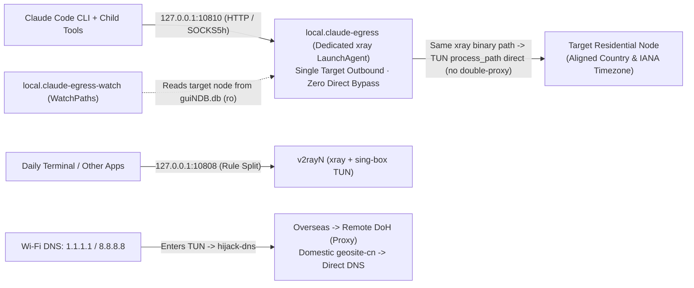

# claude-code-clean-env-macos

**English** | **[简体中文](./README.zh-CN.md)**

> A general-purpose **macOS** Agent Skill & toolkit for running **Claude Code CLI** inside an isolated, leak-resistant, privacy-hardened network environment: dedicated single-node `xray` egress, zero CN split-routing leak, DNS/IPv6 leak prevention, target-city timezone & locale parity, OAuth browser interception for fingerprint browsers, and binary-verified telemetry opt-outs.

---

## Key Features

- **Dedicated Isolated Egress (`127.0.0.1:10810`)**: Runs a dedicated `xray` `LaunchAgent` locked to a single target residential node with **zero direct/CN split-routing rules**. Child tools (`Bash`, `WebFetch`, `curl`, `git`) never leak your domestic ISP IP, and switching nodes in v2rayN's GUI never causes mid-session IP drift.
- **Zero-Touch Auto-Sync**: Reads your target node directly from v2rayN's SQLite database (`guiNDB.db`, read-only) regardless of which node is currently selected in the GUI. A macOS `WatchPaths` `LaunchAgent` automatically syncs subscription updates with SHA-256 idempotency (never restarts running sessions unless credentials actually change), backed by startup self-healing in the `claude()` shell wrapper.
- **Fail-Closed Launch Guard**: Verifies egress port health, live exit country, and target IANA timezone before every `claude` launch; refuses to start on any mismatch instead of silently falling back to direct connections.
- **System DNS Leak Prevention (Zero Domestic Slowdown)**: Routes macOS Wi-Fi DNS (`1.1.1.1 / 8.8.8.8`) into `sing-box` TUN `hijack-dns` so overseas queries use remote DoH while domestic domains (`geosite-cn`) stay on fast local DNS. Includes one-command `dns_tun` / `dns_auto` toggles for captive-portal Wi-Fi or proxy-off usage.
- **Process-Scoped Timezone & Locale Parity**: Injects target-city `TZ` (e.g. `America/New_York`) and `en_US.UTF-8` strictly into `claude` and its subprocesses without altering your macOS system clock.
- **OAuth System-Browser Interception**: Uses a `BROWSER` interceptor script (`claude-no-open`) to block macOS `/usr/bin/open` from launching Safari/Chrome, automatically copying the OAuth URL to your clipboard for pasting into an isolated/fingerprint browser.
- **Binary-Verified Privacy Calibration**: Calibrated against Claude Code `2.1.x` native binary internals to disable telemetry, crash reporting, GrowthBook feature flags, session uploads, feedback drafts, and background auto-updates—while avoiding real-world pitfalls (`DISABLE_UPDATES=1` breaking manual updates, `CLAUDE_CODE_ATTRIBUTION_HEADER=0` over-hardening, and the falsy-value trap).
- **One-Command Red-Team Audit**: Includes `audit_env.sh` to verify dedicated egress, Cloudflare edge (`colo`), CN-domain isolation, true direct IPv6 (`--noproxy '*'`), overseas DNS egress, privacy guardrails, and optional Safarier fingerprint browser parity.

---

## Architecture



---

## Critical OPSEC Warning

> [!CAUTION]
> **NEVER** install this skill into `~/.claude/skills/` or `~/.agents/skills/`!  
> Claude Code scans both directories and injects discovered skill names and descriptions into its prompt context. Install this skill **only** in a separate local AI assistant directory (such as Antigravity's `~/.gemini/config/skills/`), or run the scripts manually.

---

## Quick Start

### Option A: Install as an Agent Skill (Recommended for Antigravity or Other Non-Claude Agents)

```zsh
git clone https://github.com/shakelight1/claude-code-clean-env-macos.git
mkdir -p ~/.gemini/config/skills
cp -R claude-code-clean-env-macos/skills/claude-clean-env-macos ~/.gemini/config/skills/
chmod +x ~/.gemini/config/skills/claude-clean-env-macos/scripts/*.sh \
         ~/.gemini/config/skills/claude-clean-env-macos/scripts/*.py
```

Then ask your separate AI assistant (not Claude Code):

> Use the `claude-clean-env-macos` skill to configure and audit my macOS Claude Code clean environment. My target v2rayN node remarks name is `<YOUR_NODE_REMARKS>`.

### Option B: Manual Deployment from Templates

1. Install helper scripts to `~/.local/bin/`:
   ```zsh
   mkdir -p ~/.local/bin
   cp skills/claude-clean-env-macos/scripts/claude-egress-sync.py ~/.local/bin/claude-egress-sync
   cp skills/claude-clean-env-macos/scripts/claude-no-open.sh ~/.local/bin/claude-no-open
   chmod +x ~/.local/bin/claude-egress-sync ~/.local/bin/claude-no-open
   ```
2. Customize and apply:
   - [zshrc.snippet.zsh](./skills/claude-clean-env-macos/references/templates/zshrc.snippet.zsh) → `~/.zshrc`
   - [settings.json.example](./skills/claude-clean-env-macos/references/templates/settings.json.example) → `~/.claude/settings.json`
3. Render `__HOME__` and `__NODE_REMARKS__` in both LaunchAgent templates and load them via `launchctl bootstrap`:
   - [local.claude-egress.plist.template](./skills/claude-clean-env-macos/references/templates/local.claude-egress.plist.template)
   - [local.claude-egress-watch.plist.template](./skills/claude-clean-env-macos/references/templates/local.claude-egress-watch.plist.template)
4. Run initial sync and full leak audit:
   ```zsh
   CLAUDE_EGRESS_NODE_REMARKS="<YOUR_NODE_REMARKS>" ~/.local/bin/claude-egress-sync
   CLAUDE_EXPECTED_COUNTRY="US" CLAUDE_EXPECTED_TZ="America/New_York" \
     ./skills/claude-clean-env-macos/scripts/audit_env.sh
   ```

---

## Repository Structure

```text
claude-code-clean-env-macos/
├── README.md                                            # English documentation
├── README.zh-CN.md                                      # 简体中文完整文档
├── LICENSE                                              # MIT License
└── skills/
    └── claude-clean-env-macos/
        ├── SKILL.md                                     # Generalized macOS Skill runbook
        ├── scripts/
        │   ├── audit_env.sh                             # Parameterized red-team audit script
        │   ├── claude-egress-sync.py                    # Zero-touch v2rayN DB -> xray sync
        │   └── claude-no-open.sh                        # macOS OAuth browser interceptor
        └── references/
            ├── architecture.md                          # Architecture, binary audit & pitfalls
            └── templates/
                ├── settings.json.example                # Hardened ~/.claude/settings.json
                ├── zshrc.snippet.zsh                    # Zsh proxy, fail-closed & auto-heal wrapper
                ├── local.claude-egress.plist.template   # Dedicated xray LaunchAgent template
                └── local.claude-egress-watch.plist.template # Auto-sync WatchPaths LaunchAgent template
```

---

## Common Pitfalls Avoided

- **Do NOT set `DISABLE_UPDATES=1`**: Blocks manual `claude update`. Use `DISABLE_AUTOUPDATER=1` instead.
- **Do NOT set `CLAUDE_CODE_ATTRIBUTION_HEADER=0`**: Strips the standard `x-anthropic-billing-header` (version/entrypoint only), making client requests stand out without adding privacy.
- **Watch out for the falsy-value trap**: Flags like `CLAUDE_CODE_DISABLE_NONESSENTIAL_TRAFFIC`, `DISABLE_TELEMETRY`, and `DISABLE_ERROR_REPORTING` evaluate any non-empty string (`"0"`, `"false"`) as enabled; delete keys rather than setting them to `"0"`.
- **Don't blindly trust MaxMind's `America/Chicago` on broadcast IPs**: Broadcast ranges without city records default to the US geographic center (Kansas, UTC-6). Always verify using `https://claude.ai/cdn-cgi/trace` (`colo`) + multiple GeoIP sources (`ipinfo.io`, `ip-api.com`, `ipwho.is`).
- **Terminal / VS Code Terminal + Fingerprint Browser > Electron Desktop App**: Electron desktop apps ignore `~/.zshrc` and inherit system proxy, system timezone, and OS font fingerprints.

---

## License

For network isolation, privacy protection, and developer tooling research. Comply with local laws and platform Terms of Service.  
Licensed under the [MIT License](./LICENSE).
