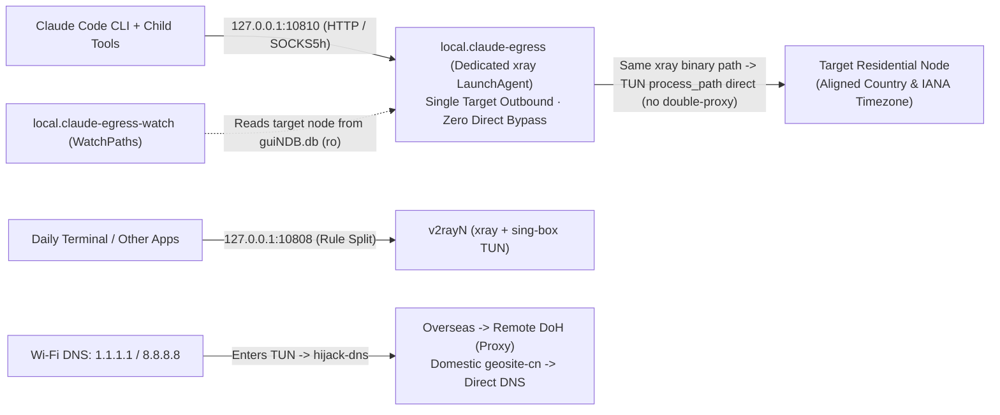

# claude-code-clean-env-macos

> A general-purpose **macOS** Agent Skill & toolkit for running **Claude Code CLI** inside an isolated, leak-resistant, privacy-hardened network environment (dedicated single-node egress, zero CN split-routing leak, DNS/IPv6 leak prevention, timezone/locale parity, OAuth browser interception, and binary-verified telemetry opt-outs).

一个面向 **macOS** 的通用 **Claude Code CLI 纯净防泄漏环境配置技能与脚本套件**。把整套红蓝对抗验证过的隔离策略打包为开箱即用的 Agent Skill，适用于搭配 **v2rayN（TUN + xray）** 或任意本地代理工具与指纹浏览器使用的场景。

---

## 核心特性 / Key Features

- **独立单节点专用出口（Dedicated Isolated Egress）**：为 Claude Code 单独运行一个只包含目标节点（如美国家宽）的 `xray` 守护进程（默认 `127.0.0.1:10810`），**零国内直连分流规则**，彻底消除国内站点暴露真实宽带 IP，并免疫日常代理软件中途切换节点导致的 IP 跳变。
- **零手动全自动同步（Zero-Touch Auto-Sync）**：直接只读监听 `v2rayN` 的 SQLite 数据库（`guiNDB.db`），哪怕 GUI 当前停留在其他节点，刷新订阅后也由 macOS `LaunchAgent` (`WatchPaths`) 后台幂等同步目标节点；配合 `claude()` 启动自愈，平时无需敲任何同步命令。
- **Fail-Closed 启动熔断**：每次启动 `claude` 前实时核验专用端口、出口国家与目标 IANA 时区，任一项不匹配直接拒绝启动，绝不静默回落直连。
- **系统 DNS 零泄漏（不拖慢国内访问）**：通过将 macOS Wi-Fi DNS 指向公网地址引入 `sing-box` TUN `hijack-dns`，海外域名走远程 DoH，国内 `geosite-cn` 仍走国内直连 DNS；内置 `dns_tun` / `dns_auto` 一键切换以兼容公共认证 Wi-Fi 或裸连场景。
- **时区 & Locale 进程级对齐**：仅在 `claude` 及其子进程作用域内注入目标城市 IANA 时区（如 `America/New_York`）与 `en_US.UTF-8`，不改动 macOS 系统时钟。
- **OAuth 登录防误弹系统浏览器**：内置 `BROWSER` 拦截脚本，阻止 Claude Code 在 macOS 上自动唤起 Safari/Chrome，自动将授权链接复制到剪贴板供粘贴至隔离/指纹浏览器。
- **基于真实二进制审计的隐私反追踪**：基于 Claude Code 2.1.x 原生二进制源码实测校准 `settings.json`，关闭遥测、错误上报、GrowthBook 特性开关、会话上传、后台自动更新与反馈草稿；避开 `DISABLE_UPDATES=1`（会锁死手动更新）、`CLAUDE_CODE_ATTRIBUTION_HEADER=0`（过度加固）及“非空即真”等常见误区。
- **一键红蓝全链路审计脚本**：内附 `audit_env.sh`，自动核查端口、实时机房（`colo`）、国内站点隔离、真实直连 IPv6（`--noproxy '*'`）、海外 DNS 出口、隐私配置红线与指纹浏览器一致性。

---

## 架构概览 / Architecture



---

## ⚠️ OPSEC 重要警告（安装位置）

> [!CAUTION]
> **严禁**将本 Skill 放入 `~/.claude/skills/` 或 `~/.agents/skills/`！  
> Claude Code 启动时会扫描上述目录并将 Skill 名称和描述注入上下文发送至服务端。请**仅将本 Skill 安装在独立于 Claude Code 的其他本地 AI 助手目录**中（例如 Antigravity 的 `~/.gemini/config/skills/`），或仅作为运维脚本手册在本地手动使用。

---

## 快速开始 / Quick Start

### 方式一：作为 Agent Skill 安装（推荐，适用于 Antigravity 等独立助手）

```zsh
git clone https://github.com/shakelight1/claude-code-clean-env-macos.git
mkdir -p ~/.gemini/config/skills
cp -R claude-code-clean-env-macos/skills/claude-clean-env-macos ~/.gemini/config/skills/
chmod +x ~/.gemini/config/skills/claude-clean-env-macos/scripts/*.sh \
         ~/.gemini/config/skills/claude-clean-env-macos/scripts/*.py
```

随后在你的独立 AI 助手（**非 Claude Code**）对话中直接说：

> 使用 `claude-clean-env-macos` 技能，为我配置并验收 macOS 下的 Claude Code 纯净环境，我的目标节点备注名是 `<你的节点名称>`。

### 方式二：手动按模板部署

1. 复制脚本到 `~/.local/bin/` 并赋权：
   ```zsh
   mkdir -p ~/.local/bin
   cp skills/claude-clean-env-macos/scripts/claude-egress-sync.py ~/.local/bin/claude-egress-sync
   cp skills/claude-clean-env-macos/scripts/claude-no-open.sh ~/.local/bin/claude-no-open
   chmod +x ~/.local/bin/claude-egress-sync ~/.local/bin/claude-no-open
   ```
2. 按实际节点名与时区编辑并合并：
   - [zshrc.snippet.zsh](./skills/claude-clean-env-macos/references/templates/zshrc.snippet.zsh) → `~/.zshrc`
   - [settings.json.example](./skills/claude-clean-env-macos/references/templates/settings.json.example) → `~/.claude/settings.json`
3. 渲染并加载两个 `LaunchAgent`（将模板中的 `__HOME__` 与 `__NODE_REMARKS__` 替换为实际值）：
   - [local.claude-egress.plist.template](./skills/claude-clean-env-macos/references/templates/local.claude-egress.plist.template)
   - [local.claude-egress-watch.plist.template](./skills/claude-clean-env-macos/references/templates/local.claude-egress-watch.plist.template)
4. 首次同步并跑一键全链路审计：
   ```zsh
   CLAUDE_EGRESS_NODE_REMARKS="<你的节点备注名>" ~/.local/bin/claude-egress-sync
   CLAUDE_EXPECTED_COUNTRY="US" CLAUDE_EXPECTED_TZ="America/New_York" \
     ./skills/claude-clean-env-macos/scripts/audit_env.sh
   ```

---

## 目录结构 / Repository Structure

```text
claude-code-clean-env-macos/
├── README.md
├── LICENSE
└── skills/
    └── claude-clean-env-macos/
        ├── SKILL.md                                     # 通用 macOS 运维与排错手册
        ├── scripts/
        │   ├── audit_env.sh                             # 红蓝全链路泄漏审计脚本（参数化）
        │   ├── claude-egress-sync.py                    # v2rayN SQLite -> 独立 xray 自动幂等同步
        │   └── claude-no-open.sh                        # macOS OAuth 系统浏览器拦截器
        └── references/
            ├── architecture.md                          # 架构原理、二进制审计方法与避坑清单
            └── templates/
                ├── settings.json.example                # Claude Code 隐私加固配置模板
                ├── zshrc.snippet.zsh                    # Zsh 代理注入、熔断与自愈封装模板
                ├── local.claude-egress.plist.template   # 独立 xray 守护进程 LaunchAgent 模板
                └── local.claude-egress-watch.plist.template # 订阅变更自动监听 LaunchAgent 模板
```

---

## 常见误区提示 / Pitfalls Avoided

- **不要设 `DISABLE_UPDATES=1`**：会直接阻断手动 `claude update`；只设置 `DISABLE_AUTOUPDATER=1` 即可关闭后台静默更新同时保留手动升级能力。
- **不要设 `CLAUDE_CODE_ATTRIBUTION_HEADER=0`**：该头仅包含版本号与入口标识（`x-anthropic-billing-header`），关闭不增加隐私，反而使请求特征异于正常客户端。
- **警惕“非空即真”陷阱**：`CLAUDE_CODE_DISABLE_NONESSENTIAL_TRAFFIC`、`DISABLE_TELEMETRY`、`DISABLE_ERROR_REPORTING` 在源码中采用非空判断，写 `"0"` 或 `"false"` 同样会生效；不需要时应直接删除键名。
- **切勿轻信单一 MaxMind 检测站的 `America/Chicago`**：广播 IP 缺少精确城市数据时，MaxMind 常回退至美国几何中心默认时区；应以 `https://claude.ai/cdn-cgi/trace` 的 `colo` 机房代码结合 `ipinfo.io` / `ip-api.com` / `ipwho.is` 交叉核验。
- **不要在桌面端（Claude Desktop）依赖本方案**：Electron 桌面壳不读 `~/.zshrc`，会直接继承系统代理、系统时区与中文字体指纹；推荐 **终端 / VS Code 集成终端 + 独立指纹浏览器** 组合。

---

## 免责声明与许可 / License

本项目仅用于网络隔离、隐私保护与开发运维研究，请遵守所在地区法律法规及各平台服务条款。  
Released under the [MIT License](./LICENSE).
