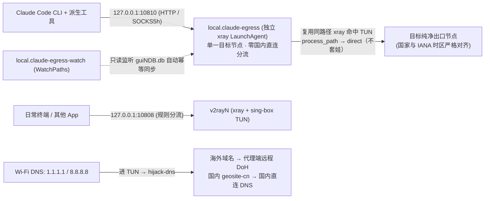

# claude-code-clean-env-macos

**[English](./README.md)** | **简体中文**

> 一套面向 **macOS** 的通用 **Claude Code CLI 纯净防泄漏环境配置技能与脚本工具包**。  
> 经过红蓝对抗实测校准，解决「规则分流暴露国内真实 IP」「中途切节点跳 IP」「路由器绕过 TUN 造成 DNS 泄漏」「广播 IP 时区误判」「OAuth 误弹系统浏览器」「过度加固锁死手动更新」等真实痛点，支持搭配 **v2rayN（TUN + xray）** 或其他本地代理软件与独立指纹浏览器实现日常**无感使用**。

---

## 它帮你解决什么问题？（核心能力）

1. **Claude 专用单节点独立出口（`127.0.0.1:10810`）**
   - 单独运行一个只包含目标节点（如美国家宽）的 `xray` 后台守护进程，**没有任何国内直连分流规则**。
   - 哪怕 Claude Code 调用 Bash 工具、`curl` 或 `WebFetch` 访问国内站点，也强制从目标节点出网，绝不暴露本机宽带 IP，更不会把真实 IP 写进对话记录上传。
   - 与 v2rayN 日常使用的 `10808` 完全解耦：你在 v2rayN 里随便切换其他国家节点，正在跑的 Claude Code 会话**完全不受影响**。
2. **零手动、全自动无感同步（Zero-Touch Auto-Sync）**
   - 同步脚本直接以只读方式查询 v2rayN 的 SQLite 数据库（`guiNDB.db`），按节点备注名提取目标节点——**即使 v2rayN 当前停留在别的节点上也能精准同步**。
   - 通过 macOS `LaunchAgent`（`WatchPaths`）后台监听订阅库变更，并做 SHA-256 幂等比对：参数没变直接跳过，**绝不重启、不打断运行中的会话**；凭据更新则先跑 `xray run -test` 验证通过后再热重载。
   - 配合 `claude()` 启动自愈：平时无需手动敲任何同步命令，打开终端直接敲 `claude` 即可。
3. **Fail-Closed 启动熔断守卫**
   - 每次启动 `claude` 前实时检查 `10810` 端口存活、出口国家与目标 IANA 时区完全匹配；任一项不符合直接拒绝启动，绝不静默回落直连。
4. **系统 DNS 防泄漏（且不拖慢国内访问）**
   - 解决 macOS Wi-Fi 默认使用路由器内网 DNS（`192.168.x.1`）绕过 TUN 导致海外域名查询泄漏给国内运营商的问题。
   - 将 Wi-Fi DNS 设为 `1.1.1.1 / 8.8.8.8` 引入 `sing-box` TUN 的 `hijack-dns`：海外域名走代理端远程 DoH，国内 `geosite-cn` 依然走国内直连 DNS，不影响日常国内网速；内置 `dns_tun` / `dns_auto` 一键切换，兼容关代理裸连和酒店/咖啡馆认证 Wi-Fi。
5. **进程级时区与语言对齐**
   - 在 `claude` 进程及其所有子进程作用域内精准对齐目标城市 IANA 时区（如 `America/New_York`）与 `en_US.UTF-8`，**不改动 macOS 系统时钟**。
6. **OAuth 登录防误弹系统浏览器**
   - 通过 `BROWSER` 拦截脚本阻止 Claude Code 调用 macOS `/usr/bin/open` 唤起 Safari/Chrome，自动将授权链接复制到剪贴板，粘贴进你的独立/指纹浏览器完成登录。
7. **基于真实二进制源码校准的隐私反追踪**
   - 直接对照 Claude Code `2.1.x` 原生二进制校准 `settings.json`，关闭遥测、错误上报、GrowthBook 特性开关、会话上传、后台自动更新、反馈调研与模型起草反馈工具，同时避开多个常见坑点。
8. **一键红蓝对抗体检脚本（`audit_env.sh`）**
   - 自动验证独立出口、`claude.ai` 实际接入机房（`colo`）、国内站点出口隔离、真实直连 IPv6（`--noproxy '*'`）、海外 DNS 解析器、配置红线与可选 Safarier 指纹浏览器一致性。

---

## 整体架构



---

## ⚠️ OPSEC 隔离警告（极其重要）

> [!CAUTION]
> **严禁将本 Skill 放到 `~/.claude/skills/` 或 `~/.agents/skills/` 目录中！**  
> Claude Code 启动时会扫描上述两个目录，并将 Skill 的名称和描述注入上下文发送给服务端。  
> 请**仅安装到独立于 Claude Code 之外的本地 AI 助手目录**（例如 Antigravity 的 `~/.gemini/config/skills/`），或者仅在本地手动执行脚本与模板。

---

## 快速开始

### 方式一：作为 Agent Skill 安装（推荐，配合 Antigravity 等独立助手）

```zsh
git clone https://github.com/shakelight1/claude-code-clean-env-macos.git
mkdir -p ~/.gemini/config/skills
cp -R claude-code-clean-env-macos/skills/claude-clean-env-macos ~/.gemini/config/skills/
chmod +x ~/.gemini/config/skills/claude-clean-env-macos/scripts/*.sh \
         ~/.gemini/config/skills/claude-clean-env-macos/scripts/*.py
```

安装完成后，在你的独立 AI 助手（**不是 Claude Code**）里直接用自然语言说：

- **首次部署**：「用 `claude-clean-env-macos` 技能，帮我配置并验收 macOS 下的 Claude Code 纯净环境，我的 v2rayN 目标节点名是 `<你的节点备注名>`。」
- **随时体检**：「用 `claude-clean-env-macos` 给我做一次全链路防泄漏体检。」
- **换节点/换城市**：「我换了新的美国家宽节点，用 `claude-clean-env-macos` 重新测真实机房时区并同步对齐。」
- **升级后校准**：「刚跑完 `claude update`，用 `claude-clean-env-macos` 扫描新版二进制看看有没有新增遥测开关。」

### 方式二：手动按模板部署

1. **安装本地脚本**到 `~/.local/bin/`：
   ```zsh
   mkdir -p ~/.local/bin
   cp skills/claude-clean-env-macos/scripts/claude-egress-sync.py ~/.local/bin/claude-egress-sync
   cp skills/claude-clean-env-macos/scripts/claude-no-open.sh ~/.local/bin/claude-no-open
   chmod +x ~/.local/bin/claude-egress-sync ~/.local/bin/claude-no-open
   ```
2. **合并 Shell 与 Claude 隐私配置**（按你的节点名与城市时区修改占位值）：
   - [zshrc.snippet.zsh](./skills/claude-clean-env-macos/references/templates/zshrc.snippet.zsh) → `~/.zshrc`
   - [settings.json.example](./skills/claude-clean-env-macos/references/templates/settings.json.example) → `~/.claude/settings.json`
3. **部署两个后台自启与监听 LaunchAgent**（将模板中 `__HOME__` 替换为 `$HOME`，`__NODE_REMARKS__` 替换为你在 v2rayN 中的准确节点名）：
   - [local.claude-egress.plist.template](./skills/claude-clean-env-macos/references/templates/local.claude-egress.plist.template) → `~/Library/LaunchAgents/local.claude-egress.plist`
   - [local.claude-egress-watch.plist.template](./skills/claude-clean-env-macos/references/templates/local.claude-egress-watch.plist.template) → `~/Library/LaunchAgents/local.claude-egress-watch.plist`
4. **首次同步、加载服务并运行全链路体检**：
   ```zsh
   CLAUDE_EGRESS_NODE_REMARKS="<你的节点备注名>" ~/.local/bin/claude-egress-sync
   UID_NUM=$(id -u)
   launchctl bootstrap "gui/${UID_NUM}" ~/Library/LaunchAgents/local.claude-egress.plist
   launchctl bootstrap "gui/${UID_NUM}" ~/Library/LaunchAgents/local.claude-egress-watch.plist

   CLAUDE_EXPECTED_COUNTRY="US" CLAUDE_EXPECTED_TZ="America/New_York" \
     ./skills/claude-clean-env-macos/scripts/audit_env.sh
   ```

---

## 日常终端快捷命令速查

| 命令 | 作用 | 什么时候用 |
| :--- | :--- | :--- |
| `claude` | **正常启动 Claude Code** | 日常写代码直接敲（系统终端和 VS Code 集成终端均可），后台自动核验出口与自愈 |
| `proxy_check` | **快速体检** | 一眼查看日常 `10808`、专用 `10810`、国内站隔离、直连 IPv6 和海外 DNS 状态 |
| `dns_auto` | **切回自动 DNS（DHCP）** | 临时需要关掉 v2rayN 裸连国内网，或连酒店/咖啡馆需要网页登录认证的 Wi-Fi 时 |
| `dns_tun` | **恢复防泄漏 DNS** | 重新打开 v2rayN TUN 后一键恢复 |
| `claude update` | **手动升级稳定版** | 后台静默更新已关闭，需要升级时手动执行 |

---

## 仓库目录结构

```text
claude-code-clean-env-macos/
├── README.md                                            # 英文主文档
├── README.zh-CN.md                                      # 简体中文完整文档
├── LICENSE                                              # MIT 开源协议
└── skills/
    └── claude-clean-env-macos/
        ├── SKILL.md                                     # 通用 macOS 运维与排错技能手册
        ├── scripts/
        │   ├── audit_env.sh                             # 参数化红蓝全链路审计脚本
        │   ├── claude-egress-sync.py                    # v2rayN SQLite -> 独立 xray 自动幂等同步
        │   └── claude-no-open.sh                        # macOS OAuth 系统浏览器拦截器
        └── references/
            ├── architecture.md                          # 架构原理、二进制审计方法与避坑对照表
            └── templates/
                ├── settings.json.example                # Claude Code 隐私加固配置模板
                ├── zshrc.snippet.zsh                    # Zsh 代理、熔断与自愈封装模板
                ├── local.claude-egress.plist.template   # 独立 xray 守护进程 LaunchAgent 模板
                └── local.claude-egress-watch.plist.template # 订阅监听自动同步 LaunchAgent 模板
```

---

## 已踩过并帮你避开的真实大坑

| 误区 | 后果 | 本方案做法 |
| :--- | :--- | :--- |
| 设置 `DISABLE_UPDATES=1` | 源码直接拦截手动 `claude update` 并退出 | 删除该键，只保留 `DISABLE_AUTOUPDATER=1` |
| 设置 `CLAUDE_CODE_ATTRIBUTION_HEADER=0` | 去掉正常客户端都带的版本/入口计费头，不增隐私反让请求显眼 | 不设置该键，保持与正常客户端一致 |
| 写 `"0"` / `"false"` 试图关闭 `DISABLE_*` | 多个开关采用非空即真判断，写 `"0"` 反而启用禁用 | 不需要时直接删除该键 |
| 轻信单一 MaxMind 站点显示 `America/Chicago` | 广播 IP 缺城市数据时默认回退美国几何中心（堪萨斯 UTC-6） | 以 `claude.ai/cdn-cgi/trace` 的 `colo` 机房 + 多库交叉核验为准 |
| 测 IPv6 泄漏不加 `--noproxy '*'` | 请求进了代理，测试结果永远“假干净” | 强制 `curl -6 --noproxy '*'` 真实直连测试 |
| 用本方案套 Claude Desktop 桌面端 | Electron 桌面端不读 `~/.zshrc`，外壳走系统代理、系统时区和本机中文字体指纹 | 推荐 **终端 / VS Code 集成终端 + 独立指纹浏览器** 组合 |

---

## 免责声明与开源许可

本项目仅用于网络隔离、隐私保护与开发运维研究，使用时请遵守所在地区法律法规及各平台服务条款。  
基于 [MIT License](./LICENSE) 开源。
